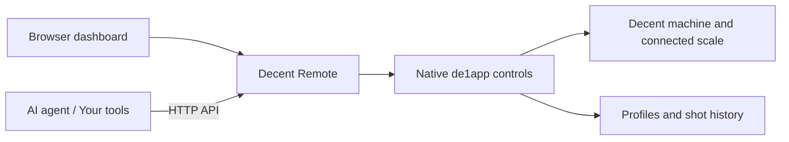

# Decent Remote

### A new way to work with classic de1app

**Browser dashboard · Integration API · Runs on your local network**

[简体中文](README.zh-CN.md) · [Screenshots](docs/SCREENSHOTS.md) · [API reference](docs/API.md) · [Agent guide](docs/AGENTS.md) · [Install](#install)

Your profiles, your shot history, your familiar de1app workflow—with more ways to use them.

Decent Remote brings machine status, recipe adjustments, profile editing and shot review to a browser. Its documented API gives AI agents and other tools access to the same controls, so you can work with your Decent from a larger screen or make it part of your own workflow.

The project grew out of two goals: bring more of the remote-control experience of newer apps to people who prefer classic de1app, and give AI agents a dependable way to read and adjust the machine through native app functions.

**Version 0.3.4** · [Download the plugin](https://github.com/Chowjw-Vibecode/de1app-plugin-decent-remote/releases/latest)

Device-tested baseline: **classic de1app 1.46.1.1 + Streamline**.

*Charts replay anonymized samples from a real shot in the released dashboard. Names, dates, dose/yield summaries and surrounding status values are demonstration data.*

## From a shot to your next adjustment

### Keep the essentials in view

The Current page brings temperature, pressure, machine flow, scale weight and recipe settings together. Five named shortcuts use the tablet’s favorite profiles and order. Select one to load its recipe without starting the machine. Adjust dose, target yield or temperature without overwriting the saved profile. Try a change, review the result, then decide whether to keep it.

### Give profiles room to work

Preview profiles, edit advanced stages, organize favorites and import local Tcl profiles or de1app v2 advanced-profile JSON files. The editor exposes pressure or flow control, temperature, duration, stage weight and early-exit conditions.

Loading, applying, saving, saving a copy and restoring a file are separate actions. Basic profiles can also be loaded and their recipes adjusted; individual stage editing is available for advanced profiles.

### Read the shot, then make the call

History charts use the tablet's recorded samples and familiar de1app colors. Move the pointer over a chart to inspect a sample, expand the view, or download the original file for analysis in your own tools.

When you load a profile from a history entry, the app loads the current saved profile file. The old shot's temporary recipe remains part of that shot's record.

## One control path, two ways in

Use the dashboard yourself, or connect an agent through HTTP. Both routes go through Decent Remote and the app's native controls.

The plugin runs inside de1app on the tablet. There is no cloud account to create or separate server to install. Profiles and shot history remain in the app's existing data folders.

## What is included

| Area | Capabilities |
|---|---|
| Machine and recipe | Status, dose, target yield, temperature, wake, sleep and stop |
| Profiles | Preview, load, advanced stage editing, import, save, save as, restore and favorites |
| Shot history | Browse records, inspect chart samples, zoom and download original files |
| Scale | Status, tare, supported stop-by-weight policies, connection settings and optional HDS sleep/wake integration |
| Everyday settings | Preheat, automatic sleep, screen brightness, scheduled wake and smart charging |
| Water and steam | Native flush, hot-water and steam settings |
| Integrations | Structured reads, parameter updates, request-result tracking and compatibility routes for existing clients |

Switch between **English and Chinese**, or **light and dark** themes. The dashboard is designed for landscape tablets and desktop browsers. Names and notes you have written stay as you wrote them.

Some functions depend on the skin, hardware or optional plugins; see [compatibility](docs/COMPATIBILITY.md). **Remote start is disabled by default**, and the webpage cannot enable the master switch. Native group-head restrictions still apply. Wake brings the machine out of sleep; it does not start a shot.

### Let your HDS scale follow the machine

The optional HDS integration puts a compatible scale into soft sleep when the machine sleeps, then resumes weighing when the machine wakes. With de1app’s keep-scale-on setting enabled, it uses soft sleep rather than the native power-off path. Bluetooth pairing, weight readings and tare still use de1app’s native scale support.

This feature is disabled on a fresh installation. It must be enabled for a compatible HDS scale; the plugin does not identify the hardware revision automatically. See [setup and compatibility](docs/COMPATIBILITY.md#hds-scale-integration).

## Built for agent-assisted workflows

“Review my last shot.” “Set this recipe to 18 g in and 36 g out.” “Save that as a new profile.”

Decent Remote provides the data and controls your agent needs for those tasks. You choose the agent and model; interpretation and conversation happen in that tool. A useful sequence is: **read → discuss the change → submit the authorized update → check the result**.

An integration needs to know more than whether an HTTP request succeeded. The API distinguishes:

| Result | What it establishes |
|---|---|
| Request accepted | The service accepted the request |
| App readback | The requested values can be read from de1app |
| Profile-frame confirmation | The corresponding native profile frames were acknowledged |

An app readback is not proof of a completed physical action. Profile-frame confirmation does not establish actual flow, temperature stability or beverage weight; those require shot data.

**Saving from the dashboard:** A new connection, page reload, profile load or restore starts without a confirmation for this page. To save a copy of unchanged current settings, select **Resend profile**, wait for confirmation, then save. If this page has no unresolved transfer, saving a newly edited draft applies it and waits for confirmation first. After an unconfirmed transfer, further edits still require an explicit resend; repeated Save clicks do not retry it.

Every non-GET request to the v1 API requires a unique request ID. IDs are optional on legacy compatibility routes; integrations should use v1. Only one profile write can be in flight at a time, while status reads and stop remain available. If a result is unknown, the client can query it before deciding what to do next. Commanded flow, machine-reported flow, scale-derived flow, inlet volume and beverage weight retain their distinct meanings.

This is an HTTP API. Connect it through your agent's HTTP tools or an adapter; no MCP server is bundled. Start with the [agent guide](docs/AGENTS.md) and [API reference](docs/API.md).

## Install

1. Extract **`decent_remote-v0.3.4.zip`**, the install package. Use this asset rather than GitHub's automatic source-code download.
2. Copy the extracted `decent_remote/` folder into the `plugins/` directory inside your de1app data folder. The final path must end in `plugins/decent_remote/plugin.tcl`, without an extra nested folder. A common classic Android location is `/sdcard/de1plus/plugins/`.
3. Enable **Decent Remote** in de1app's plugin list, then restart the app while the machine is idle. If you already use a remote-control or scale-sleep plugin, follow the [migration notes](docs/COMPATIBILITY.md) first.
4. On the same network, open **`http://TABLET_IP:8888/`** in a browser, substituting the tablet's Wi-Fi IP address.
5. A fresh installation uses **`admin1234`**. Change it on the tablet under **Plugins → Decent Remote → Settings**. Existing installations retain their key.

**Remember connection** optionally stores the key in this browser. **Forget connection** removes it. de1app must stay running for the service to be available. The service uses HTTP and is intended for a trusted local network; do not expose it directly to the Internet.

**Update:** preserve `settings.tdb` and `usage-state.tdb` (if present), copy the new package files over the existing plugin files, and restart de1app while idle. The install archive does not include these local files.

**Disable or roll back:** disable the plugin and restart de1app. To roll back, restore the earlier plugin files while retaining the configuration. Existing profiles and shot history stay in their original folders.

## Compatibility and release status

Decent Remote is an independent community project. It uses classic de1app's native control functions and does not replace machine firmware. It aims to extend the classic workflow, without promising every feature of newer apps.

Validation combines automated tests and physical-device checks on a **Samsung tablet running classic de1app 1.46.1.1 / Streamline, connected to a Decent DE1PRO**.

- **On the device:** state and scale readback, profile browsing, reversible settings, access-key saving and sleep/wake behavior. Focused checks included two sleep/wake cycles and automatic loading of 79 history records. An earlier candidate passed read-only previews of all 123 profiles in both languages; later revisions received focused checks of affected paths, not another complete 123-profile run.
- **Automated:** native-call and network-response simulations exercise API behavior, failures and browser interactions without operating equipment.
- **Still unverified:** other app versions, skins and devices, and physical remote-start actions.

See [validation scope](docs/VALIDATION.md) for results and remaining gaps, the [changelog](CHANGELOG.md) for version history, and the [gallery](docs/SCREENSHOTS.md) for more interface views.

## Development and contributions

The source bundle includes the plugin, dashboard, API documentation, automated tests and packaging tools. A GitHub Actions workflow runs the offline checks. See [development](docs/DEVELOPMENT.md) to run the suite or build an install archive.

Compatibility reports, interface feedback and integration ideas are welcome. Include the app and skin versions, steps to reproduce, and screenshots with sensitive information removed. Keep access keys and private shot records out of public reports.

This project is released under **GPL-3.0-only**. Third-party components retain their own notices; see [LICENSE](LICENSE) and [THIRD_PARTY.md](THIRD_PARTY.md).

[简体中文](README.zh-CN.md) · [Release notes](docs/RELEASE.md) · [API](docs/API.md) · [Development](docs/DEVELOPMENT.md) · [Data & privacy](docs/USAGE.md)
