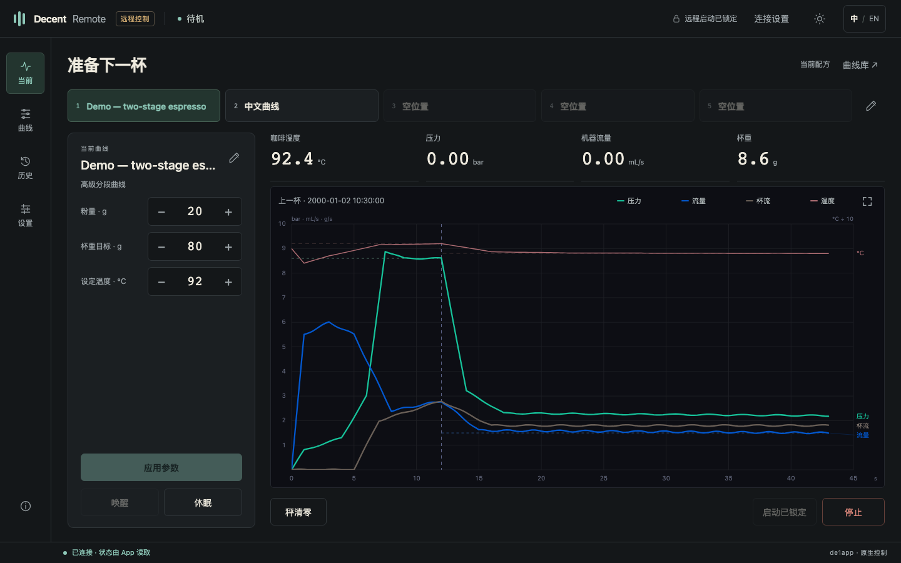
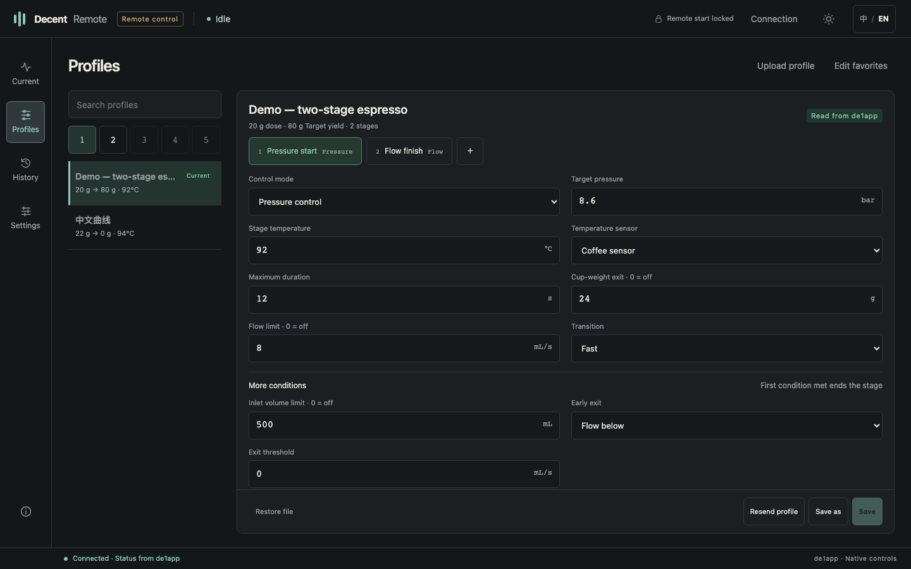
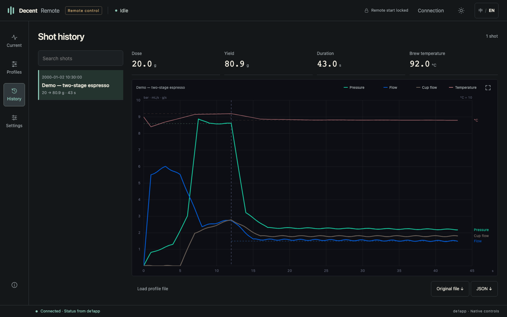
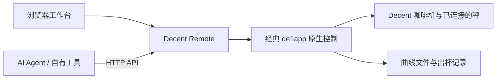

# Decent Remote

### 经典 de1app 的远程工作台

**浏览器控制 · 开放接口 · 局域网运行**

[English](README.md) · [界面预览](docs/SCREENSHOTS.md) · [接口文档](API.md) · [Agent 接入](docs/AGENTS.md) · [安装](#安装)

Decent 的魅力，在于你能看见每一次萃取，也能决定下一次如何调整。Decent Remote 把这份控制能力延伸到浏览器和 AI Agent：查看机器状态、编辑曲线、调整配方、复盘出杯，都可以通过同一套接口完成。

我们希望，使用经典 de1app 的人，能够在保留熟悉的 App、曲线库和日常操作习惯的同时，获得更多新版 App 式的远程控制体验。对于习惯与 AI Agent 一起研究咖啡的人，这个项目也提供了一条直接、可查询结果的机器交互路径。

**版本 0.3.4** · [下载安装包](https://github.com/chowjw-code/de1app-plugin-decent-remote/releases/latest) · [使用地区统计](https://chowjw-code.github.io/de1app-plugin-decent-remote/)  
已实机验证的基础环境：**classic de1app 1.46.1.1 + Streamline**。本包用于经典 de1app。

*本文截图来自实际网页，使用合成演示数据展示界面，不是实测出杯记录。*

## 从这一杯，到下一次调整

### 看见机器正在做什么

当前页集中显示温度、压力、机器流量、秤重和配方。五个常用曲线按钮与平板共用名称和顺序，点击即可加载配方，不会启动机器。粉量、目标出液和温度可以直接调整；网页把临时应用与保存文件分开，让一次尝试保留为一次尝试，直到你决定保存。

### 把曲线编辑放到更大的屏幕上

在浏览器里预览曲线、编辑高级分段、维护常用列表，或上传本地 Tcl 与 de1app v2 JSON 文件。压力控制、流量控制、温度、时长、阶段杯重和提前切段条件，都在分段编辑器中呈现。

导入、载入、临时应用、保存、另存和恢复，各自有明确入口。基本曲线也能载入并调整配方；逐段编辑适用于高级曲线。

### 让出杯记录成为调整的依据

记录页读取平板保存的原始出杯数据，按 de1app 的配色呈现曲线。移动鼠标即可查看相应采样点的数据，也可以放大图表、下载原始文件，交给自己的工具或 Agent 继续分析。

从历史记录进入下一次冲煮时，载入的是当前保存的曲线文件；历史那一杯的临时参数仍属于历史记录。

## 两种入口，同一套控制逻辑

你可以直接使用网页，也可以让自己的程序或 AI Agent 调用接口。两者都通过 Decent Remote 进入 de1app 原生控制流程。

插件运行在平板的 de1app 内，不需要云端账号，也不需要另装一台服务器。现有曲线和历史继续保存在 de1app 的数据目录中。

## 可以控制到哪里

| 范围 | 功能 |
|---|---|
| 机器与配方 | 状态读取、粉量、目标出液、温度、唤醒、休眠、停止 |
| 曲线管理 | 预览与载入、高级分段编辑、本地导入、保存、另存、恢复、常用曲线 |
| 出杯记录 | 历史列表、曲线读数、放大、原始文件下载 |
| 秤与停杯 | 秤状态、清零、支持的称重停止策略与秤连接设置 |
| 日常设置 | 预热、自动休眠、屏幕亮度、定时唤醒、智能充电 |
| 出水参数 | 冲洗、热水与蒸汽的原生参数设置 |
| 集成接口 | 结构化读取、参数写入、请求结果查询、已有客户端的兼容路径 |

中英文与深浅色可以随时切换。界面针对横屏平板和电脑浏览器设计，曲线名称及你自己填写的内容保持原样。

部分功能依赖皮肤、设备或可选插件。完整条件见[兼容与迁移](docs/COMPATIBILITY.md)。**远程启动默认关闭**，网页不能启用启动总开关；原生冲煮头控制器的限制仍然生效。唤醒只解除休眠，不启动萃取。

## 为 AI Agent 留出一个清晰的接口

你可以把“看一下刚才这杯”“把这条曲线改成 18 g、36 g 出液”“保存为另一条方案”交给自己的 Agent。Decent Remote 提供完成这些动作所需的数据与接口，具体模型、分析和对话由你选用的 Agent 提供。

推荐的协作过程是：**读取 → 分析与提出调整 → 执行获准的修改 → 查询结果并读回**。

为了让工具知道操作进行到了哪一步，接口区分三种结果：

| 结果 | 能说明什么 |
|---|---|
| 请求已接受 | 服务收到并接受了请求 |
| App 已读回 | de1app 中可以读取到对应参数 |
| 曲线帧已确认 | 这次发送的原生曲线数据已获得对应确认 |

参数读回不等于机器已经完成物理动作。曲线帧确认也不代表实际流量、温度和杯重达到目标；这些需要出杯数据来验证。

**网页保存提示：** 刚连接、刷新页面、载入或恢复曲线后，网页没有本次发送的确认。若要直接另存当前参数，请先点“重新发送”；确认完成后再保存或另存。本页没有待处理的未确认发送时，编辑新草稿后首次保存会自动应用并等待确认。已有未确认发送时，即使再次编辑，也须先明确重发；重复点击保存不会重发。

接口为 HTTP API，可通过 Agent 的 HTTP 工具或自建适配器使用。v1 接口的非 GET 请求必须使用唯一编号；旧兼容路径的编号为可选，建议新接入统一使用 v1。同一时间只允许一笔曲线写入在途。结果未知时先查询，读取状态与停止仍可用。进水体积、杯中重量、流量指令和实测流量分别提供、分别理解。

接入方式见 [Agent 指南](docs/AGENTS.md)、[中文 API](API.md) 和 [English API](docs/API.md)。

## 安装

1. 使用安装包 **`decent_remote-v0.3.4.zip`**，解压得到 `decent_remote/` 文件夹。GitHub 自动生成的源码包不是直接安装包。
2. 将文件夹放入 de1app 数据目录下的 `plugins/`。最终路径应为 `plugins/decent_remote/plugin.tcl`，不要多套一层目录。经典 Android 安装常见位置为 `/sdcard/de1plus/plugins/`。
3. 在 de1app 插件列表中启用 **Decent Remote**，机器待机时重启 App。已有远程或秤休眠插件的用户，先按[兼容与迁移说明](docs/COMPATIBILITY.md)停用冲突插件。
4. 电脑或手机连接同一网络，打开 **`http://平板IP:8888/`**。
5. 全新安装使用默认密钥 **`admin1234`**。在平板插件列表 → **Decent Remote → 设置** 中修改；已有安装保留原密钥。

“记住连接”可将密钥保存在当前浏览器中；“忘记连接”会清除它。插件需要 de1app 持续运行。服务使用普通 HTTP，适用于可信局域网，请勿直接暴露到公网。

**更新：** 保留 `settings.tdb` 和已有的 `usage-state.tdb`，将新文件复制覆盖到原插件目录，再于待机时重启。安装包不包含这些本地文件。

**停用或回退：** 停用插件并重启；回退时恢复旧版文件，同时保留配置。曲线和历史继续留在 de1app 原目录中。

## 使用地区统计

为了解 Decent Remote 在各地的使用情况，按国家／地区汇总安装数量。随机安装编号用于去重，不发送姓名、账户、曲线或出杯记录。统计保存在 Cloudflare，GitHub 只展示汇总。发布版已配置正式统计服务。[查看地区汇总](https://chowjw-code.github.io/de1app-plugin-decent-remote/)。[统计方式与停用方法](docs/USAGE.md)。

## 关于这个版本

Decent Remote 是独立社区项目。它调用经典 de1app 的原生控制方法，不替换机器固件，也不宣称与新版 App 的全部功能相同。

已实机验证的基础环境为 **classic de1app 1.46.1.1 / Streamline**。0.3.3 界面修复已通过密钥保存返回、两次休眠／唤醒、中文名称及 79 条历史自动加载的定向实机回归。本次 0.3.4 在 0.3.3 界面修复基础上增加地区统计客户端及汇总发布工具，Cloudflare 统计服务已部署，发布版已写入正式地址。曲线预览补充了原生基本参数，列表自动读取完整名称和配方；当前验证范围见 [VALIDATION.md](docs/VALIDATION.md)。其他版本、皮肤和设备的兼容性尚未验证。

完整测试结果和未覆盖范围集中在[验证说明](docs/VALIDATION.md)，版本变化见[更新记录](CHANGELOG.md)。截图集中在[界面预览](docs/SCREENSHOTS.md)。

## 开发与参与

源码包包含插件、网页、接口文档、离线测试和打包工具。测试通过模拟原生方法与网络响应运行，不连接咖啡设备。GitHub Actions 工作流随源码提供，详见[开发说明](docs/DEVELOPMENT.md)。

欢迎反馈不同 de1app 版本和皮肤下的兼容情况、界面问题与接口需求。反馈时请附 App／皮肤版本、复现步骤和去除敏感信息的截图，不要提交访问密钥或私人出杯资料。

项目采用 **GPL-3.0-only**。第三方组件保留原声明，见 [LICENSE](LICENSE) 与[来源说明](THIRD_PARTY.md)。

[English](README.md) · [发布说明](docs/RELEASE.md) · [API](API.md) · [开发](docs/DEVELOPMENT.md)
