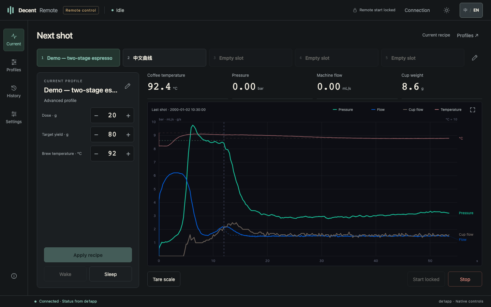
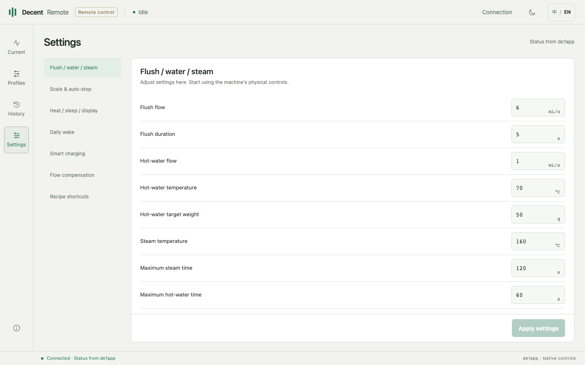

# Introducing Decent Remote · 0.3.4

[中文说明](../README.zh-CN.md) · [Install ZIP / 安装包](https://github.com/chowjw-code/de1app-plugin-decent-remote/releases/download/v0.3.4/decent_remote-v0.3.4.zip) · [Source ZIP / 源码包](https://github.com/chowjw-code/de1app-plugin-decent-remote/releases/download/v0.3.4/decent-remote-v0.3.4-source.zip)

## Your classic de1app workflow, with more ways to connect

Decent Remote brings the controls and data of classic de1app to a browser—and makes them available to AI agents through a documented HTTP API.

Keep the app, profiles and shot history you already use. Open a larger screen to adjust a recipe, work through an advanced profile, or inspect a shot. Connect your own agent to help with analysis and authorized changes through the same native control path.

### A workspace for the whole adjustment cycle

- **See the machine:** temperature, pressure, machine flow, scale weight and the current recipe in one view.
- **Shape the next shot:** load one of five named favorites from the Current page; adjust dose, target yield and temperature; edit advanced stages; import Tcl profiles or de1app v2 advanced-profile JSON files.
- **Keep experiments intentional:** preview, load, apply, save, save as and restore are separate actions.
- **Learn from the result:** inspect recorded chart samples, zoom, and download the tablet's original shot files.
- **Connect your tools:** query structured state, submit changes and inspect request results through the API.
- **Let your HDS scale follow the machine:** optional soft sleep and wake integration for compatible scales; disabled on a fresh installation. Pairing, readings and tare remain native to de1app.
- **Make it yours:** English or Chinese, light or dark, favorites and supported native settings.

### Built around de1app

The plugin runs inside the classic app and uses its native control functions. No cloud account or separate server is required for remote control. Profiles and history stay in the app's existing folders.

The API distinguishes a request being accepted, values being read back from the app, and native profile frames being acknowledged. Those states are not presented as proof that a physical shot completed. The browser also blocks saving an edited profile while its transfer remains unconfirmed; retries require an explicit action.

Remote start is disabled by default. Wake, sleep and stop retain their native behavior, including group-head restrictions.

### Packages and setup

| Package | Use |
|---|---|
| `decent_remote-v0.3.4.zip` | Install in the classic de1app `plugins/` directory |
| `decent-remote-v0.3.4-source.zip` | Source, bilingual documentation, screenshots, offline tests and build tools |

Enable the plugin, restart de1app while idle, then open `http://TABLET_IP:8888/` on the same network. A fresh installation uses `admin1234`; change it in the tablet's Decent Remote settings. Existing installations retain their key. Preserve `settings.tdb` and any `usage-state.tdb` when updating.

Full steps: [English README](../README.md) · [API reference](API.md) · [Agent guide](AGENTS.md).

### Tested compatibility

Version 0.3.4 is installed on one classic de1app **1.46.1.1 + Streamline** tablet. An earlier candidate passed read-only previews of all 123 profiles in both languages. Later changes received focused checks of affected paths, not another full-library run. Separate physical-device checks covered state and scale readback, reversible settings, access-key saving and sleep/wake behavior. Automated tests additionally simulate native calls and network responses. Other configurations and physical start actions have not been verified. See [validation scope](VALIDATION.md).

Decent Remote is an independent community project, prepared under GPL-3.0-only. It does not replace firmware or promise every feature of newer apps. This package is for classic de1app, not Decaid.

*Charts replay anonymized samples from a real shot in the released dashboard. Names, dates, dose/yield summaries and surrounding status values are demonstration data.*

## 中文说明

### 保留熟悉的 de1app，打开新的使用方式

Decent Remote 为经典 de1app 增加浏览器工作台和 HTTP 接口。你可以在更大的屏幕上查看机器、调整配方、编辑曲线和复盘出杯，也可以让自己的 AI Agent 通过接口协助分析与调整。

项目始于两个想法：让老 App 用户尽可能获得更多新版 App 式的远程控制体验；让习惯用 AI Agent 研究咖啡的人，有一条直接、可查询执行结果的机器交互路径。

**这一版覆盖了从设置到复盘的日常流程：**

- 读取温度、压力、机器流量、秤重和当前配方。
- 从主屏五个常用按钮直接载入曲线，调整粉量、目标出液与温度，编辑高级分段，上传本地 Tcl 曲线，或导入 de1app v2 高级曲线 JSON。
- 分开处理预览、载入、临时应用、保存、另存和恢复。
- 查看历史曲线、逐点读数、放大和下载原始文件。
- 设置常用、预热、休眠、亮度、充电及定时唤醒。
- 可选 HDS 秤软休眠／唤醒联动；全新安装默认关闭，配对、称重和清零沿用原生功能。
- 通过 API 读取、修改和查询请求结果，供自有工具与 Agent 接入。

插件在 de1app 内运行，沿用原生控制方法。远程控制不需要云端账号或独立服务器；曲线和历史继续保存在原目录。支持中英文和深浅色切换，用户自定义名称保持原样。

安装使用 `decent_remote-v0.3.4.zip`，放入 `plugins/` 目录，启用后于待机时重启 App。在同一网络打开 `http://平板IP:8888/`。全新安装默认密钥 `admin1234`，可在平板插件设置页修改；更新时保留 `settings.tdb` 与已有的 `usage-state.tdb`。

**已验证环境：classic de1app 1.46.1.1 / Streamline。** 0.3.4 已安装到一台 classic de1app 1.46.1.1 / Streamline 平板，较早候选版本已完成 123 条曲线的中英文逐条只读预览；后续修改做了定向复测，没有再次全量遍历。另有真实设备验证覆盖状态及秤读数、可逆设置、密钥保存和休眠／唤醒，并通过自动化测试验证模拟调用与网络响应。远程启动默认关闭；本轮未启动出水、蒸汽或磨豆。

[完整中文说明](../README.zh-CN.md) · [接口文档](../API.md) · [验证范围](VALIDATION.md) · [更多截图](SCREENSHOTS.md)

[Data & privacy / 数据与隐私](USAGE.md)

*Documentation and screenshots refreshed on 2026-10-28; plugin runtime files are unchanged. / 2026-10-28 更新说明与截图，插件运行文件未变。*
