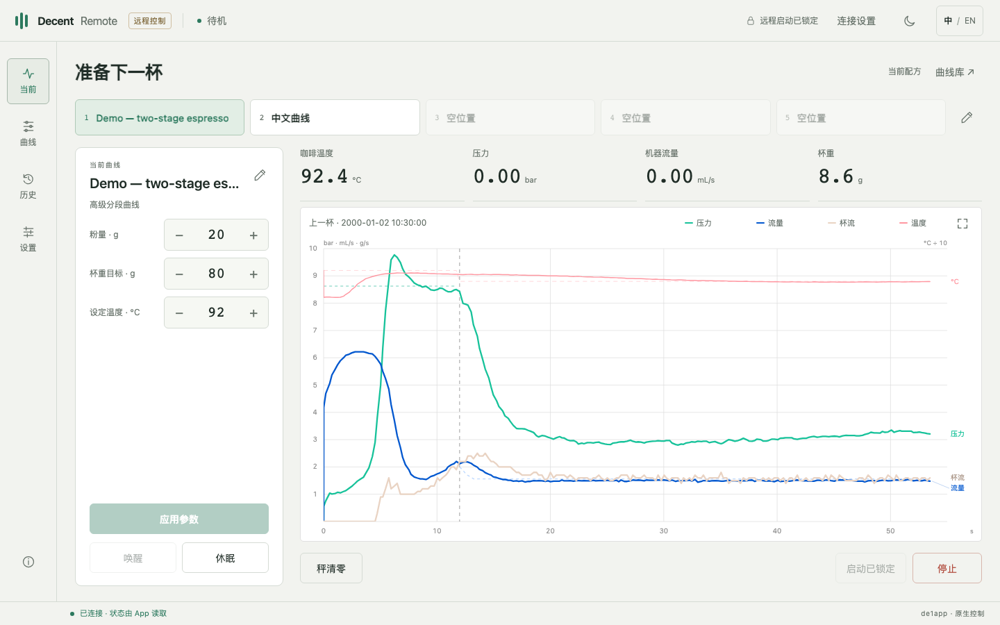

# Screenshots / 界面截图

[English README](../README.md) · [中文 README](../README.zh-CN.md)

These images render the released HTML at 1440 × 900. Chart traces replay anonymized numeric samples from a real shot, without replacing them with interpolated demonstration curves. Names, dates, recipe labels, dose/yield summaries and surrounding status values are illustrative. Rendering runs offline with intercepted requests and does not operate equipment. Profile names are user content and do not change with the interface language.

以下截图使用正式 HTML，以 1440 × 900 渲染。图表回放真实出杯的匿名数值采样，不再使用插值拼出的演示曲线。名称、日期、配方标签、粉量／出液摘要及周边状态为演示值。截图通过离线回放生成，不操作设备；用户自定义名称不随界面语言翻译。

## Current · English · Dark

## 当前 · 中文 · 深色

## Profiles · Advanced stage editor

## History · Recorded sample view

## Settings · English · Light

## 当前 · 中文 · 浅色

## Generate screenshots / 生成截图

Run `REMOTE_SCREENSHOT_DIR=docs/images REMOTE_SCREENSHOT_SHOT=/path/to/local-shot.json node tests/dashboard.test.cjs` with a local de1app v2 shot record. The renderer copies only the numeric chart series; identifying metadata is not used. Raw shot files are not distributed. Omitting `REMOTE_SCREENSHOT_SHOT` uses synthetic test data, so those captures will have different chart shapes from this gallery.

使用本地 de1app v2 出杯记录运行上述命令。渲染器只读取图表数值序列，不使用身份信息；发布包不包含原始出杯文件。省略 `REMOTE_SCREENSHOT_SHOT` 时使用合成测试数据，生成的曲线形状与本页不同。
